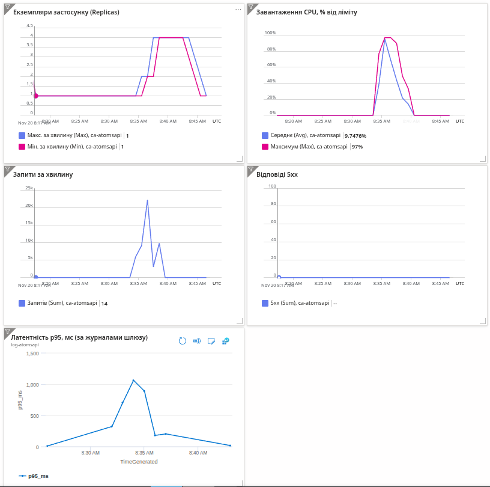
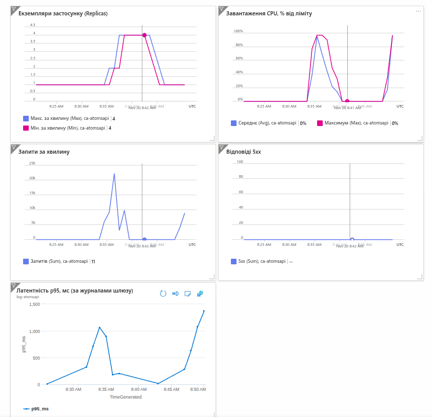
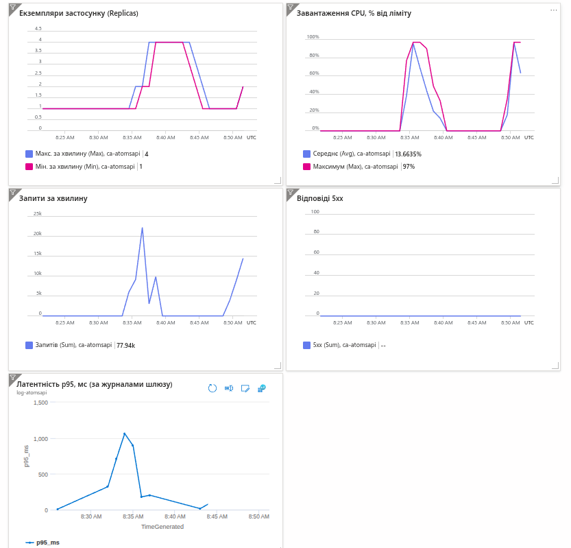
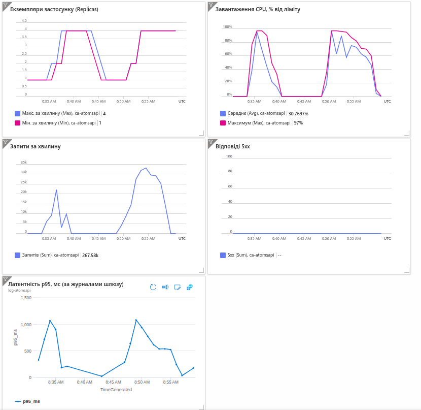

# Автоматичне масштабування

## Параметри (infra/app.tf, infra/variables.tf)
| Параметр | Значення | Обґрунтування |
|---|---|---|
| min_replicas | 1 | один екземпляр обслуговує фонове навантаження; 0 дав би холодний старт |
| max_replicas | 4 | обмеження лабораторної; 4 × 6 зʼєднань пулу = 24 < max_connections БД |
| Метрика | середнє завантаження CPU | автоматично відображається на графіку CPU |
| Ціль | 60% | запас до насичення: поки платформа додає екземпляр, наявні ще обробляють запити; 85-90% лишає замало запасу, 30-40% дає зайві екземпляри |
| polling interval | 30 с | як часто перевіряється метрика |
| cooldown | 300 с | див. нижче |

## Період стабілізації (cooldown)
<Що це: час, протягом якого платформа не зменшує кількість екземплярів після спаду навантаження.>

Якщо встановити 0: <екземпляри вилучаються одразу при короткому спаді і додаються знову при наступному сплеску (flapping); постійні холодні старти, втрата прогрітих зʼєднань з БД і кешу, перезапуски, зайві витрати, обірвані запити.>

## Панель під час тесту
<Знімок панелі з позначками: t0 початок навантаження, t1 перетин порогу 60% CPU, t2 поява нового екземпляра, t3 вилучення>

Чому між перетином порогу і появою екземпляра минає час:
<метрика агрегується за хвилину; перевірка раз на polling interval; створення репліки (завантаження образу, старт процесу, пробa готовності)>

Чому вилучення відбувається значно пізніше за падіння навантаження:
<cooldown 300 с, щоб не реагувати на короткі спади; додати екземпляр дешевше й безпечніше, ніж помилково вилучити>

Підсумок прогону: пік екземплярів 4, час до першого нового екземпляра 3 хвидини, повернення до 1 екземпляра через 5 хвилин після завершення тесту.