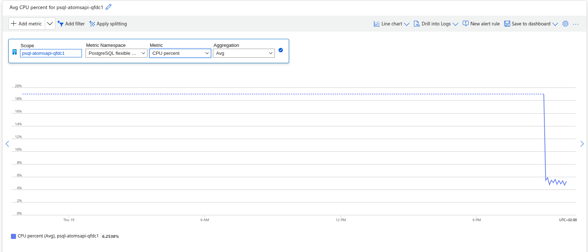
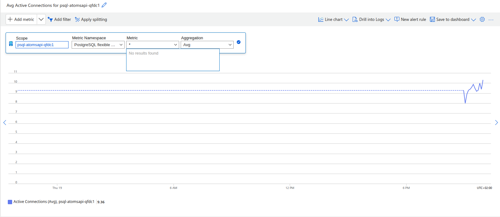

# Кешування

## Схема
Cache-aside для GET /atoms, GET /molecules (TTL 45 с ±10%) і GET /orders (інвалідація при POST). Сервіс дивиться в Redis; при промаху читає БД, зберігає результат і повертає його. Redis працює окремим контейнером у тому ж середовищі (infra/redis.tf). Якщо Redis недоступний, сервіс читає БД напряму. Захист від cache stampede: паралельні промахи по одному ключу ділять один запит до БД.

## Порівняння (одне й те саме навантаження: N=<…>, THINK=<…>)
| Показник | без кешу | з кешем |
|---|---|---|
| латентність p95 | <…> мс | <…> мс |
| запитів за секунду | <…> | <…> |
| читань з БД (/stats db_reads) | <…> | <…> |
| завантаження CPU БД (портал, пік) | <…>% | <…>% |
| частка влучань (/stats hit_ratio) | — | <…> |

## Актуальність даних
Каталог змінюється рідко: клієнт може бачити застарілі дані до <45 с ±10%>. Список замовлень інвалідується одразу після запису, тому для автора застарілість <≈ 0>. Як зменшити: <менший TTL, інвалідація при кожній зміні, write-through>; ціна: <більше звернень до БД>.

